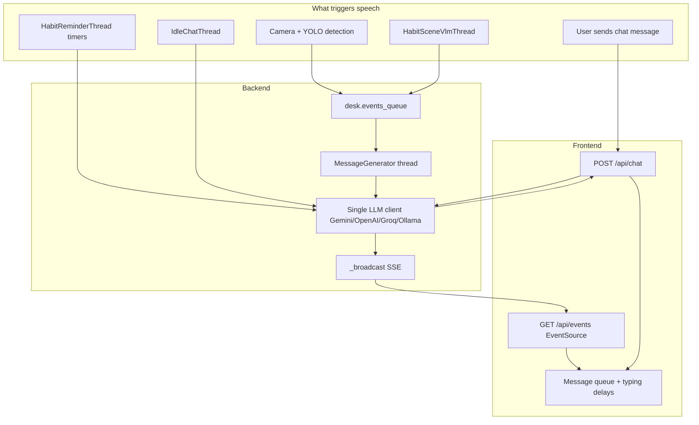

# Agent System — Prompts, Differentiation & Message Flow

This document describes how the four desk “agents” (characters) are prompted, differentiated from each other, and orchestrated end-to-end — including when each one speaks and how messages reach the UI.

---

## Overview

The “agents” in Habit Project are **not separate LLM processes**. They are four desk characters — **Computer (monty)**, **Cup (glug)**, **Snack (munch)**, and **Paper (sheets)** — all served by one shared `MessageGenerator` in `backend/server.py` that swaps **system prompts**, **context**, and **routing rules** depending on who is speaking and why.

There is also a **separate, non-character agent** in `pipeline/messaging.py`: a generic “desk safety monitoring system” used by the standalone vision pipeline for distance alerts. That is not one of the four chat characters.

---

## The Four Characters

Each character is defined in `CHARACTERS` in `backend/server.py`:

| ID | Name | Role | Personality (summary) | LLM temperature |
|---|---|---|---|---|
| `monty` | Computer | Screen breaks, posture, spill anxiety | Fragile, anxious, subtle metaphors | 0.60 |
| `glug` | Cup | Hydration | Innocent, unaware of danger | 0.75 |
| `munch` | Snack | Mindful snacking | Hedonistic, dismissive of safety | 0.90 |
| `sheets` | Paper | Tasks & focus | Gentle, anxious, deadline-oriented | 0.50 |

### How they are differentiated

1. **Personality string** — injected into every system prompt as `PERSONALITY: {char['personality']}`
2. **Object identity** — “You are {name}, a {object} on someone's desk”
3. **Habit focus** — `HABIT_FOCUS` assigns each character a coaching domain and reminder interval (e.g. glug every 30 min, monty every 20 min)
4. **Per-character widget** — todo list (sheets), break timer (monty), sip counter (glug), snack log (munch), which adds context and **action tags** like `[ADD_TODO:...]`, `[LOG_BREAK]`, `[LOG_SIP]`
5. **Rolling memory** — `desk.char_memory[char_id]` stores recent things that character said (up to 8 entries)
6. **YOLO mapping** — each character “owns” certain detected object classes (laptop → monty, cup → glug, etc.)

Each character also maps to YOLO/COCO classes for vision detection:

- **monty**: laptop, tv, keyboard, mouse
- **glug**: bottle, cup, wine glass
- **munch**: banana, apple, sandwich, orange, broccoli, carrot, hot dog, pizza, donut, cake
- **sheets**: book

---

## Architecture Overview



### Background threads (started at server boot)

| Thread | Role |
|---|---|
| `CameraThread` | YOLO detection per camera |
| `DetectionMerger` | Merges detections, runs safety analysis, emits events |
| `MessageGenerator` | Consumes `desk.events_queue`, LLM-generates proactive messages, broadcasts via SSE |
| `HabitReminderThread` | Periodic habit reminders per character |
| `IdleChatThread` | Ambient two-character banter when 2+ objects on desk |
| `HabitSceneVlmThread` | Vision-model posture/phone/focus cues |
| `LostObjectFrameworkThread` | Lost-item tracking and alerts |
| `DailySummaryThread` | End-of-day recap message |

---

## LLM Backend Selection

`MessageGenerator` picks **one** LLM client at init time (first match wins):

1. Gemini (`GEMINI_API_KEY`)
2. OpenAI (`OPENAI_API_KEY`)
3. Groq (`GROQ_API_KEY`)
4. Ollama (`OLLAMA_URL`)
5. Template fallback (no LLM — canned responses)

A separate **vision client** (`vision_client`) can use Ollama for VLM tasks while chat runs on Gemini.

All character speech goes through `_call_llm()`, which enforces `MIN_LLM_INTERVAL` (default 6s) between calls and retries on rate limits / empty Ollama responses.

---

## How Prompting Works

All character speech uses the same `_call_llm()` method, but with **different prompt templates** depending on the situation.

### 1. User-initiated chat (`generate_chat_response`)

**Entry point:** `POST /api/chat` in `backend/server.py`

Builds a rich system prompt with:

- Character personality + habit focus area
- Live desk status from `build_live_context()` (detected objects, active dangers, recent events, session duration)
- Widget data (open todos, sip count, etc.)
- Character memory (last 3–8 entries)
- Action instructions for widget commands (`_action_instructions_for`)
- Coherence rules (stay in character, don’t invent dangers, trust user corrections)

Message array structure:

```
[system prompt] → [recent history turns] → [current user message]
```

History comes from the client as `recent_messages` (last ~10 turns). Other characters’ lines in group history are prefixed with their name so the model knows who said what.

Post-processing:

- `_parse_actions()` extracts widget action tags
- `_single_speaker_text()` strips accidental multi-character dialogue
- `_response_violates_evidence()` rejects hallucinated desk facts
- `_record_memory()` saves a snippet for future consistency

Ollama gets a shorter system prompt; Gemini/OpenAI/Groq get the full coherence block.

### 2. Proactive proximity / safety events (`_llm_event`)

When objects get too close, `DetectionMerger._analyze()` emits a `proximity` event. `MessageGenerator._generate()` prompts the assigned speaker with:

- Shorter system prompt (1 sentence, max 20 words)
- A `SITUATION:` block from `_describe_event()` with vision grounding (YOLO class names, spill risk, relationship labels)
- Follow-up logic if the danger persists (`follow_up` count → escalating urgency)

If the LLM fails or violates evidence rules, `_template_event()` returns canned proximity lines per character.

### 3. Scheduled habit reminders (`generate_habit_reminder`)

`HabitReminderThread` calls this on a per-character interval from `HABIT_FOCUS`. Prompt includes widget state + optional VLM desk note (`desk.habit_vlm_brief`).

Falls back to static tips from `HABIT_FOCUS[cid]['tips']` if LLM unavailable.

### 4. Idle ambient chat (`IdleChatThread._generate_exchange`)

Two characters currently on desk exchange one sentence each:

1. Character A gets desk summary + “say something casual to B”
2. ~3–6s pause
3. Character B gets A’s line + “reply to what A said”

Both messages broadcast directly via `_broadcast()` (bypasses `events_queue`).

### 5. Lost-object queries (`answer_lost_object_query`)

Routes to Paper (sheets) in group chat. Uses structured tracking facts, optional VLM frame lookup, and `LOST_OBJECT_SHEETS_SYSTEM` prompt.

### 6. Daily summary (`DailySummaryThread`)

A neutral “Desk Talk” system prompt summarizes day stats; a **random** character delivers the broadcast.

### 7. Standalone pipeline safety (`pipeline/messaging.py`)

Separate from the four characters. System prompt:

> You are a desk safety monitoring system… 1–2 sentences MAX, name objects and risk, tell user what to move.

Used when running `main.py` pipeline independently; posts to `/api/safety`.

---

## Live Context Injection

`build_live_context(user_message)` assembles the desk status block every chat/event prompt receives:

- Objects currently tracked (with YOLO class labels and time on desk)
- Objects **not** detected
- Active dangers from `RelationshipAnalyzer` (risk level, duration, labels)
- Relationship insights
- Last VLM lost-item scan labels
- Recent interaction events (last 5)
- Session duration
- @mention resolution when user message references objects

This is the primary mechanism keeping agents grounded in camera state rather than inventing desk layout.

---

## Message Distribution

There are **two delivery channels**:

### A. Push — Server-Sent Events (`GET /api/events`)

Proactive messages are pushed to all connected clients via SSE.

`MessageGenerator._broadcast(msg)` puts JSON on every subscribed queue. The Flask route streams `data: {json}\n\n` with keepalive pings every 25s.

Frontend (`app/app.js`) listens and routes by message type:

| SSE `type` | Destination |
|---|---|
| `group_message` | Group chat + danmu overlay |
| `habit_reminder` | That character’s DM + widget refresh |
| `scenario_alert` | Group or specific character DM |

Messages are **queued client-side** (`messageQueue` / `drainMessageQueue`) with typing indicators and staggered delays (600–1400ms) so multiple agents don’t all appear at once.

### B. Pull — Chat API (`POST /api/chat`)

User messages get a **synchronous JSON response**:

```json
{
  "messages": [
    { "character": "glug", "text": "...", "reply_to": { ... } }
  ],
  "actions": [ ... ]
}
```

The frontend loops `response.messages`, shows typing per character, and applies `actions` (todo add/done, log break, etc.) in individual chats.

---

## Who Speaks, and When

### User chat — you choose the room; code chooses the speaker(s)

**Individual DM** (`chat: "monty"` etc.): exactly one character responds.

**Group chat** (`chat: "group"`): up to **2 characters** respond in sequence via `_group_speaker_order()`.

Priority for **first speaker**:

1. `@mentions` or detected name keywords (via `MENTION_MAP`: “laptop” → monty, “cup” → glug, “computer” → monty, etc.)
2. Characters involved in active dangers
3. Characters currently detected on desk
4. Random from the pool (first 4 candidates)

**Second speaker** gets a different user prompt:

- If **targeted** by name → “The user is talking to you. Respond to what they asked.”
- If **not targeted** → “React briefly… Do NOT answer the question yourself if it was directed at another object.”

Second speaker is **skipped** if the LLM returns a fallback response (`is_fallback && i > 0`).

Lost-object queries in group chat are handled by Paper (sheets) via a dedicated lookup path before normal group routing.

### Proactive speech — detection and timers decide

| Trigger | Who speaks | How it’s chosen |
|---|---|---|
| Object proximity / spill risk | One character | `RelationshipAnalyzer`: prefer `monty` or `sheets` as the “worried” one; otherwise the intruder |
| Desk edge danger | The object near the edge | That character’s ID |
| Break detected (person away 5+ min) | monty | Hard-coded in `DetectionMerger._track_auto_events` |
| Sip detected (cup gone 3–120s) | glug | Hard-coded |
| New snack class appears | munch | Hard-coded |
| Pet near desk | monty | Hard-coded |
| Phone on desk 5+ min | sheets | Hard-coded scenario alert |
| Clutter (6+ items) | sheets | Hard-coded, 30 min cooldown |
| Posture / screen time reminders | monty | Time-based in merger + VLM thread |
| Water plants reminder | glug | Daily interval |
| Scheduled habit reminder | Each character on their interval | `HabitReminderThread` |
| Idle banter | Two detected objects | `IdleChatThread` picks a pair |
| Daily summary (~9pm) | Random character | `DailySummaryThread` |
| VLM posture / phone cues | monty or sheets | `HabitSceneVlmThread` |
| Lost object missing too long | group (UI shows as monty in group) | `LostObjectFrameworkThread` |

### Speaker assignment for proximity events

From `DetectionMerger._analyze()`:

```python
speaker = target if target in ('monty', 'sheets') else intruder
```

From `safety_rules.json` pair rules:

```python
speaker = char_b if char_b in ('monty', 'sheets') else char_a
```

Monty and Paper are preferred “worried” narrators; Cup and Snack speak when they are the intruder or edge case.

---

## Gating — When Agents Stay Silent

Agents **don’t** respond on every frame. Cooldowns and policies limit spam:

| Mechanism | Default | Effect |
|---|---|---|
| `EVENT_COOLDOWN` | 25s | Minimum gap between proximity messages for same pair |
| Exponential backoff | 2^count (max 8×) | Repeat dangers within 5 min escalate cooldown |
| `MIN_LLM_INTERVAL` | 6s | Global throttle between any LLM calls |
| `HABIT_MIN_GAP_SEC` | env | Minimum gap between habit reminders per character |
| DND hours | 22:00–07:00 (configurable) | Idle chat + scheduled reminders suppressed; queued for later |
| `appeared` / `disappeared` | disabled | Objects entering/leaving frame do **not** trigger chat |
| Idle chat interval | 120–300s random | Ambient chat only when 2+ objects detected |
| Pet / clutter / focus alerts | 120s–1800s | Per-scenario cooldowns |

`_habit_dnd_active()` reads `desk.habit_policy` (DND enabled + hour window).

---

## Event Queue vs Direct Broadcast

Most proactive speech flows through `desk.events_queue` → `MessageGenerator.run()` → `_generate()` → `_broadcast()`.

Some paths **bypass the queue** and call `_broadcast()` directly:

- `HabitReminderThread` (scheduled reminders)
- `IdleChatThread` (two-message exchange)
- `DailySummaryThread`

Auto-detected events (break logged, sip detected) are queued with pre-written `text`, but `MessageGenerator._generate()` currently **re-LLMs** proximity-style prompts for non-`proximity` event types rather than passthrough-broadcasting the canned text. Scheduled reminders from `HabitReminderThread` always use `generate_habit_reminder()`.

---

## Widget Actions (chat commands)

When the user asks a character to do something, the system prompt includes action tags the LLM must emit:

| Character | Widget | Action tags |
|---|---|---|
| sheets | todo | `[ADD_TODO:…]`, `[DONE_TODO:…]`, `[DEL_TODO:…]` |
| monty | break_timer | `[LOG_BREAK]` |
| glug | sip_counter | `[LOG_SIP]` |
| munch | snack_log | `[LOG_SNACK:label]` |

`_parse_actions()` strips tags from displayed text and returns structured actions to the frontend, which updates local widget state.

---

## End-to-End Examples

### Example 1: User sends “@Cup did I drink enough water?”

1. Frontend POSTs to `/api/chat` with `chat: "group"`, message, and `recent_messages`.
2. `_parse_mentions` resolves `@Cup` → `glug`.
3. `_group_speaker_order` returns `[glug, …maybe one other]`.
4. For glug, `generate_chat_response` builds system prompt with glug’s personality, hydration focus, sip counter widget, and live desk status.
5. LLM returns text; `[LOG_SIP]` tags parsed if present.
6. Response JSON returned; frontend shows glug’s message, then optionally a second character chiming in.
7. glug’s reply recorded in `desk.char_memory['glug']`.

### Example 2: Cup moves too close to laptop

1. Camera thread detects YOLO classes → maps to character IDs via `YOLO_TO_CHAR`.
2. `DetectionMerger._analyze()` finds a zone intrusion via `RelationshipAnalyzer`.
3. Speaker = `monty` (target in worried-pair rule).
4. `_emit_interaction` applies cooldown, saves snapshot, puts event on `desk.events_queue`.
5. `MessageGenerator.run()` picks up event, calls `_llm_event('monty', …)`.
6. LLM generates short in-character warning grounded in YOLO classes.
7. `_broadcast` pushes `{type: 'group_message', character: 'monty', text: '…', snapshot: id}` via SSE.
8. Frontend enqueues with typing animation into group chat.

### Example 3: Scheduled hydration reminder

1. `HabitReminderThread` wakes every 30s, checks if 30 min elapsed for glug.
2. If not in DND and `HABIT_MIN_GAP_SEC` satisfied, calls `generate_habit_reminder('glug')`.
3. Optional VLM enrich adds one-line desk note.
4. `_broadcast({type: 'habit_reminder', character: 'glug', text: '…'})`.
5. Frontend shows in glug’s individual chat and refreshes sip widget from server.

---

## Key Source Files

| File | Responsibility |
|---|---|
| `backend/server.py` | Characters, prompts, routing, threads, Flask API |
| `backend/relationships.py` | Proximity / danger zone analysis |
| `app/app.js` | SSE client, message queue, chat UI |
| `pipeline/messaging.py` | Standalone pipeline safety LLM (non-character) |
| `docs/SYSTEM_LOGIC.md` | Standalone vision pipeline chart flow |

---

## Key Takeaway

There is **one LLM**, **four personas**, and **deterministic routing** (mentions, safety rules, timers, detection heuristics) that decides *which* persona speaks. The persona is enforced by the system prompt, post-processing (`_single_speaker_text`), and evidence checks (`_response_violates_evidence`). Timing is controlled by cooldowns, DND, and the frontend message queue — not by the models autonomously deciding when to talk.
